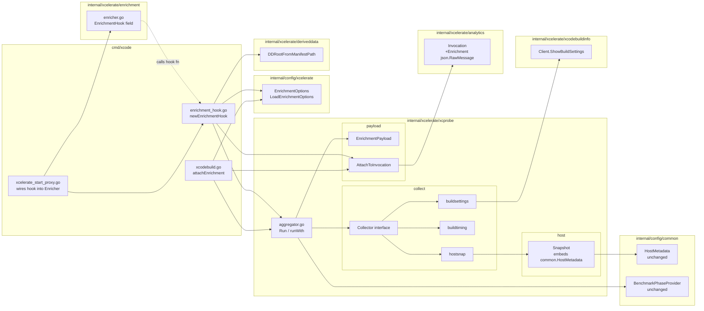
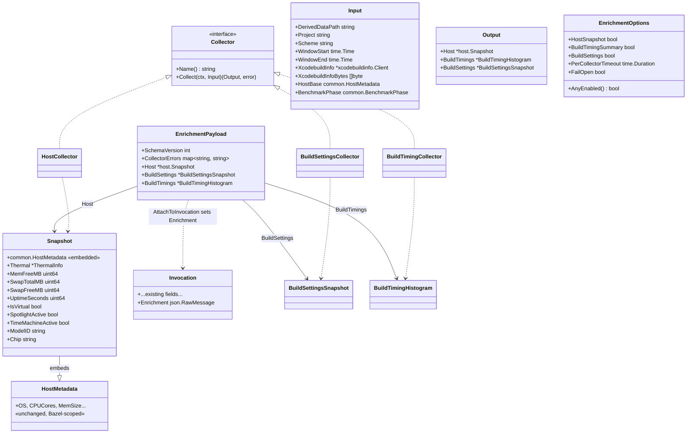
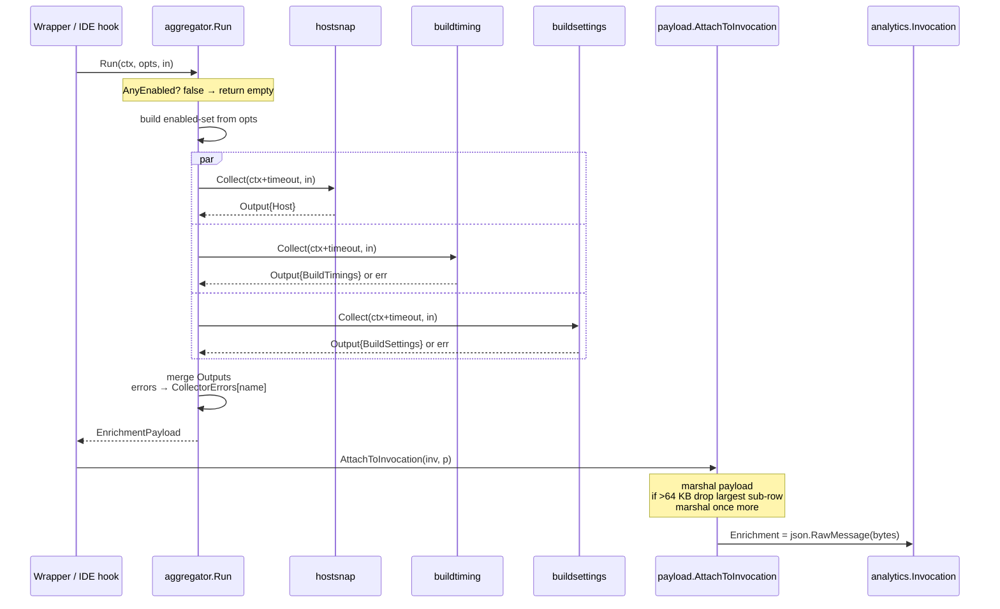
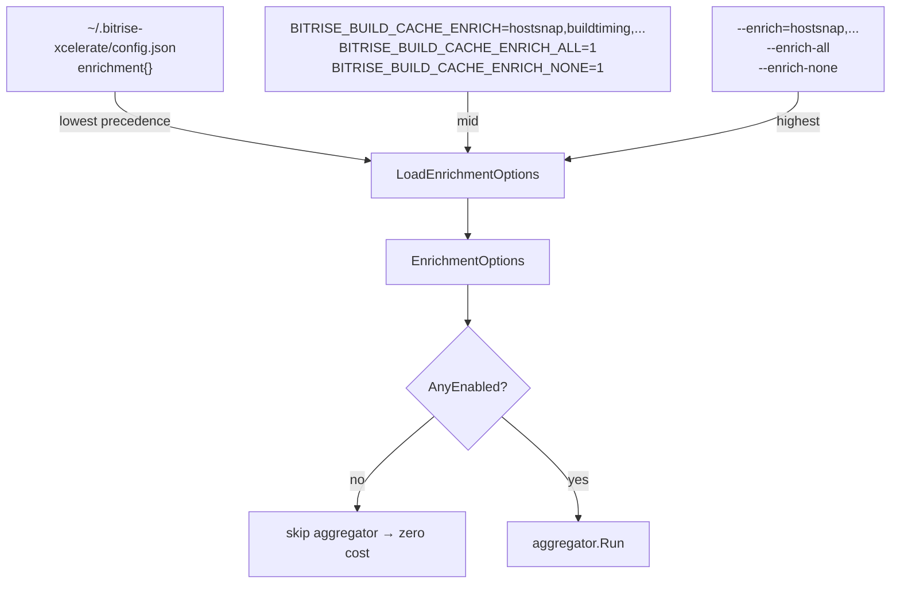
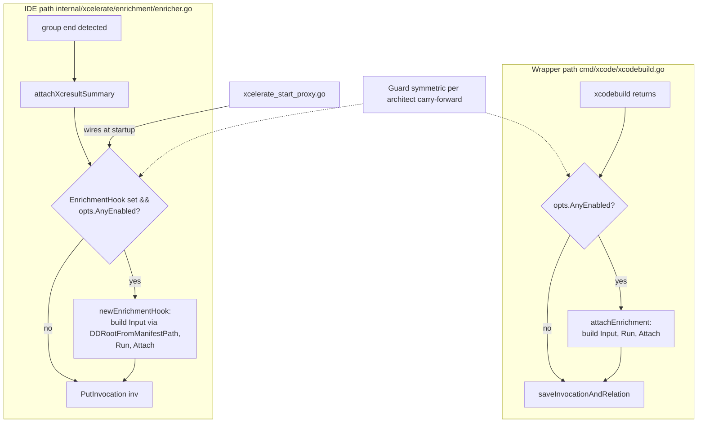
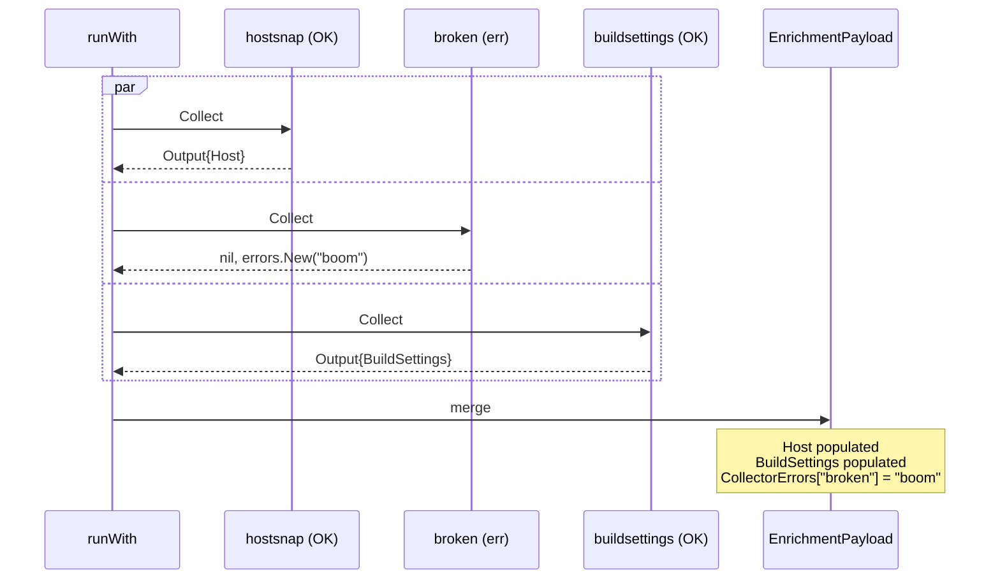
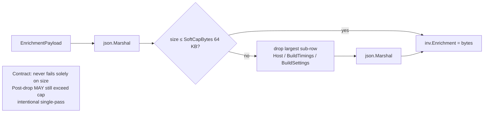
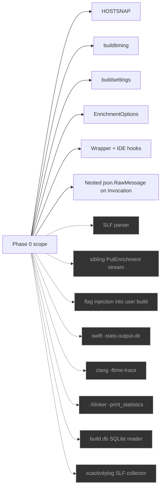

# Phase 0 — Class + Flow Diagrams

Companion to `xcode-invocation-enrichment-plan-2026-10-30.md` (rev3). Mermaid; render in any MD viewer that supports it (VS Code preview, GitHub, etc.).

## 1. Package map

Dependency rules enforced by `make lint-arch`:
- `collect/` imports no config package.
- `payload/` imports `analytics` one-way (field is `json.RawMessage`).
- `cmd/xcode` imports `aggregator` + `config/xcelerate`, nothing deeper.

## 2. Type relationships (class diagram)

## 3. Aggregator fan-out

## 4. Opt-in config resolution

`--enrich-none` beats everything else at every tier.

## 5. Two hook sites (wrapper vs IDE)

Both hooks share: same aggregator, same payload type, same AnyEnabled guard, same Attach. Only the Input-construction code differs.

## 6. Collector-error isolation

One failure never kills siblings. `FailOpen=true` is the default.

## 7. Oversize-payload soft cap

Single-pass by design; a future refactor that assumes "post-drop ≤ cap" breaks the contract — the `emit_test.go` fixture locks this in.

## 8. Phase-0 non-goals (visual reminder)

Grey nodes are out of Phase 0 — explicitly deferred to Phase 1-4 per the plan doc.
